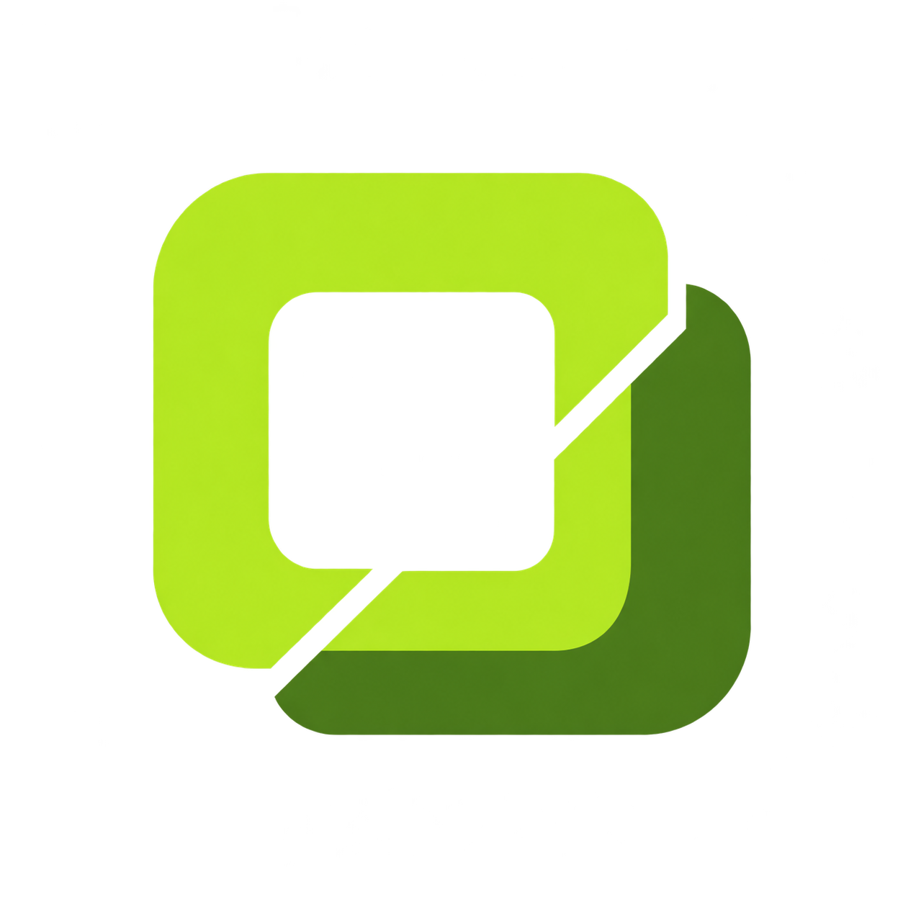

<p align="center">
  
</p>

# OliveStudio

[English](#english) · [Türkçe](#türkçe)

## English

OliveStudio is an experimental, modular 2D game editor built with Electron, TypeScript, React, and PixiJS. It puts the scene canvas at the center of the workspace and lets you build a game from scenes, reusable objects, animation, physics, and interactions. The desktop editor is developed on macOS.

**OliveStudio was developed entirely with AI, under human direction.** The project was built independently for learning and experimentation, with no commercial purpose. The editor's optional AI integrations are separate from the process used to develop it.

### MCP automation

Enable **Settings → Editor → MCP server** to let a local MCP client use the running editor. Module-owned tools cover
scene/component authoring, assets/library, animation, prefabs, scripts, Preview, presentation and HTML export. Critical
file operations require editor approval; additional folders are granted in Settings. Long operations expose jobs and
cancellation. [Automation contract and verification](packages/editor-sdk/AUTOMATION.md).

### Canvas Focus interface

The canvas stays central. **Tools** groups installed panels into Scene, Motion, Audio, Build and Automate, with search across every category. Use **⌘/Ctrl K** to find any panel, or the bottom Scene / Animate / Effects / Logic shortcuts. Library and Properties have quick access at the lower left; selecting an object reveals Properties automatically. Pin panels when needed; saved layouts and role presets remain available. Viewport options live under **View** at the lower right. Graphite uses an olive accent; Light, Warm and custom themes remain supported.

### What you can do

| Area | Features |
| --- | --- |
| Scene editing | Organize objects in a layered hierarchy. Move, rotate, and scale them on the canvas, configure snap and grid controls, and reuse object groups as prefabs. |
| Assets | Import images, audio, and compatible Spine animations into the project library. Reimport updated media while preserving references in scenes. |
| Particles | Design effects in a live Pixi preview with six presets, spawn/motion/color controls, project presets, undo and MCP automation. [Particle Editor](modules/particles/README.md). |
| Animation and sound | Animate properties with timeline keyframes, preview scene playback, and attach audio to objects or events. |
| Game behavior | Build interactions, triggers, dialogue, and scene transitions. Add optional physics, navigation, lighting, achievements, or authored scripts. |
| Preview and export | Play the scene in an isolated runtime, pause it, or step through frames. Use the HTML export for supported runtime features and inspect its compatibility report. |
| AI and extensibility | Connect LocalHub for supported assistant and media workflows, or use supported connections to LM Studio and ComfyUI. Extend the editor through modules and local plugins. |

Example projects live in [`examples/`](examples/). Editable projects use the `.pixieditor` format. Keep the adjacent `.pixieditor.assets` directory with the project when moving or sharing it so the editor can reload the source images and sounds.

### Run from source

Use **Node.js 22.12+** and **pnpm 10.34.6**. The desktop build imports the LocalHub TypeScript SDK from a sibling checkout. Place both repositories in the same parent directory and install each workspace's dependencies. Running the LocalHub service is only necessary for workflows that connect to that service.

```sh
git clone https://github.com/ErdemYesiltas/LocalHub.git localhub
git clone https://github.com/ErdemYesiltas/OliveStudio.git OliveStudio
pnpm --dir localhub/clients/typescript install --frozen-lockfile
cd OliveStudio
pnpm install --frozen-lockfile
pnpm dev
```

From the OliveStudio repository root, run `pnpm check` for type checking, linting, unit tests, and a build. Use `pnpm test:desktop` for the Electron smoke test or `pnpm package:mac` to update the single local app at `/Applications/OliveStudio.app`.

### Source layout

- [`apps/editor-desktop/`](apps/editor-desktop/) contains the Electron host, preload bridge, and editor interface.
- [`packages/`](packages/) contains the shared editor kernel, document types, SDK, and runtime.
- [`modules/`](modules/) contains the editor and runtime feature modules, including Pixi rendering, animation, audio, and export.
- [`examples/`](examples/) contains sample scenes. [`scripts/`](scripts/) contains build, verification, and packaging tools.

### Design and technology references

- Scene hierarchies, component-based authoring, and a separate play mode formed part of the design reference for the editor. [Unity 2D](https://unity.com/features/2d)
- PixiJS powers the canvas and 2D rendering. [PixiJS](https://pixijs.com/)
- The device-paired assistant and media workflow uses LocalHub's client SDK. [LocalHub](https://github.com/ErdemYesiltas/LocalHub)

### License

OliveStudio's own source is available under the [MIT License](LICENSE). Third-party dependencies retain their original terms. Using or distributing builds or exports that include Spine Runtimes is subject to the [included Spine Runtimes license](third-party/SPINE-RUNTIMES-LICENSE.txt). See [Esoteric Software's current terms](https://esotericsoftware.com/spine-runtimes-license).

## Türkçe

OliveStudio, Electron, TypeScript, React ve PixiJS ile geliştirilen deneysel, modüler bir 2B oyun editörüdür. Sahne tuvalini çalışma alanının merkezine alır. Sahneler, yeniden kullanılabilir nesneler, animasyon, fizik ve etkileşimlerle oyun prototipleri oluşturmayı sağlar. Masaüstü editörü macOS üzerinde geliştirilmektedir.

**OliveStudio, insan yönlendirmesiyle tamamen yapay zekâ kullanılarak geliştirildi.** Öğrenme ve deneme amacıyla geliştirilen bağımsız bir projedir ve herhangi bir ticari amaç gütmez. Editördeki isteğe bağlı yapay zekâ entegrasyonları, uygulamanın geliştirilmesinde yapay zekâ kullanılmasından ayrıdır.

### Neler yapabilirsiniz?

| Alan | Özellikler |
| --- | --- |
| Sahne düzenleme | Nesneleri katmanlı bir hiyerarşide düzenleyin. Tuvalde taşıyın, döndürün ve ölçekleyin. Izgara ve hizalama ayarlarını kullanın, nesne gruplarını prefab olarak yeniden kullanın. |
| Varlık kitaplığı | Görsel, ses ve uyumlu Spine animasyonlarını projeye aktarın. Sahne referanslarını koruyarak güncellenen medya dosyalarını yeniden içe aktarın. |
| Animasyon ve ses | Zaman çizelgesinde anahtar karelerle özellikleri canlandırın, sahneyi önizleyin ve nesne ya da olaylara ses bağlayın. |
| Oyun davranışı | Etkileşimler, tetikleyiciler, diyaloglar ve sahne geçişleri oluşturun. İsteğe bağlı fizik, navigasyon, ışıklandırma, başarımlar veya betikler ekleyin. |
| Önizleme ve dışa aktarma | Sahneyi ayrı bir çalışma ortamında oynatın, duraklatın veya kare kare ilerletin. Desteklenen özellikleri HTML olarak dışa aktarın ve uyumluluk raporunu inceleyin. |
| Yapay zekâ ve genişletme | Desteklenen asistan ve medya iş akışları için LocalHub’a bağlanın veya LM Studio ve ComfyUI entegrasyonlarını kullanın. Editörü modüller ve yerel eklentilerle genişletin. |

Örnek projeler [`examples/`](examples/) dizininde bulunur. Düzenlenebilir projeler `.pixieditor` biçimindedir. Görsellerin ve seslerin tekrar yüklenebilmesi için projeyi taşırken veya paylaşırken yanındaki `.pixieditor.assets` dizinini de beraber götürün.

### Kaynak koddan çalıştırma

**Node.js 22.12+** ve **pnpm 10.34.6** gerekir. Masaüstü derlemesi, LocalHub TypeScript SDK’sını yan dizindeki depodan alır. İki depoyu aynı üst dizine yerleştirip bağımlılıklarını kurun. LocalHub servisinin çalışması yalnızca ona bağlanan özellikler için gerekir.

```sh
git clone https://github.com/ErdemYesiltas/LocalHub.git localhub
git clone https://github.com/ErdemYesiltas/OliveStudio.git OliveStudio
pnpm --dir localhub/clients/typescript install --frozen-lockfile
cd OliveStudio
pnpm install --frozen-lockfile
pnpm dev
```

OliveStudio kökünde `pnpm check` ile tür denetimi, lint, birim testleri ve derlemeyi çalıştırabilirsiniz. `pnpm test:desktop` Electron temel işlev testini, `pnpm package:mac` ise `/Applications/OliveStudio.app` konumundaki tek uygulamayı günceller.

### Kaynak düzeni

- [`apps/editor-desktop/`](apps/editor-desktop/) Electron uygulamasını, preload köprüsünü ve editör arayüzünü içerir.
- [`packages/`](packages/) paylaşılan editör çekirdeğini, belge tiplerini, SDK’yı ve çalışma ortamını içerir.
- [`modules/`](modules/) Pixi çizimi, animasyon, ses ve dışa aktarma dâhil editör ve çalışma ortamı modüllerini içerir.
- [`examples/`](examples/) örnek sahneleri, [`scripts/`](scripts/) ise derleme, doğrulama ve paketleme araçlarını içerir.

### Tasarım ve teknoloji referansları

- Sahne hiyerarşisi, bileşen tabanlı düzenleme ve ayrı oynatma modu editör tasarımının referansları arasındaydı. [Unity 2D](https://unity.com/features/2d)
- Tuval ve 2B çizim PixiJS ile çalışır. [PixiJS](https://pixijs.com/)
- Cihaz eşleştirmeli asistan ve medya akışı LocalHub istemci SDK’sını kullanır. [LocalHub](https://github.com/ErdemYesiltas/LocalHub)

### Lisans

OliveStudio’ya ait kaynak kod [MIT Lisansı](LICENSE) ile yayımlanır. Üçüncü taraf bağımlılıkların kendi lisans koşulları geçerlidir. Spine Runtimes içeren derlemelerin veya dışa aktarımların kullanımı ve dağıtımı, [depoda bulunan Spine Runtimes lisansının](third-party/SPINE-RUNTIMES-LICENSE.txt) koşullarına tabidir. [Esoteric Software’in güncel koşulları](https://esotericsoftware.com/spine-runtimes-license).

## Production workflows (20 November 2026)

Nine independent feature modules now provide World, Brushes, Behavior Graph, Test Studio, Gameplay Lab, Game Data, Visual Review, Build Quality and Starter Kits/Search. The desktop host and HTML player share their runtime implementation. Setup, the 36 MCP tools, tested flows and first-release limits: [Production Tools](modules/production-tools/README.md). Implementation plan: [PLAN.md](modules/production-tools/PLAN.md).

## Single macOS application

`pnpm package:mac` (also desktop `package:mac` / `package:mac:adhoc`) builds, validates and replaces **`/Applications/OliveStudio.app`**. Signed `pnpm release:mac` uses the same app location; only distribution artifacts go in `release/`. Custom output folders are rejected. The previous app stays intact until the replacement is ready; packaging refuses to replace a running app. Retired release/QA app bundles go to macOS Trash with `restore-map.json`, preserving projects, profiles and test evidence. `pnpm build:cleanup` retires legacy generated duplicates separately. Do not make renamed QA app bundles; use separate user-data profiles or the existing Electron development executable.
